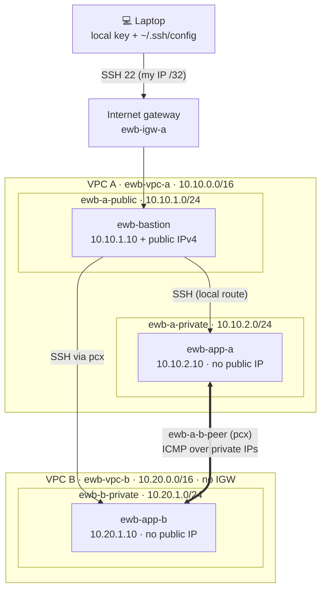

# AWS VPC Peering — EWB Courses Project 01

Two private VPCs connected by a VPC peering connection, administered through one public bastion
with SSH ProxyJump. Every step of the EWB workbook is automated with the AWS CLI, and every test
saves labelled evidence for the report.

   **Student:** Ahana Singh · **Batch:** AWS Internship Batch 1 · **Region:** `ap-south-1` (Mumbai) · **Course:** AWS Architect Associate

## Architecture



- **Administration:** laptop → bastion → App-A or App-B using SSH ProxyJump (the key never leaves the laptop).
- **Project traffic:** App-A ⇄ App-B over private IPs and the peering connection.
- Peering does **not** give VPC B internet access through VPC A.

## Address plan

| Resource | VPC / subnet | CIDR / address |
|---|---|---|
| `ewb-vpc-a` | VPC A | `10.10.0.0/16` |
| `ewb-a-public` | VPC A / public | `10.10.1.0/24` |
| `ewb-a-private` | VPC A / private | `10.10.2.0/24` |
| `ewb-vpc-b` | VPC B | `10.20.0.0/16` |
| `ewb-b-private` | VPC B / private | `10.20.1.0/24` |
| `ewb-bastion` | `ewb-a-public` | `10.10.1.10` + public IPv4 |
| `ewb-app-a` | `ewb-a-private` | `10.10.2.10`, no public IP |
| `ewb-app-b` | `ewb-b-private` | `10.20.1.10`, no public IP |

Other resources: `ewb-igw-a`, route tables `ewb-rt-a-public` / `ewb-rt-a-private` / `ewb-rt-b-private`,
security groups `ewb-sg-bastion` / `ewb-sg-app-a` / `ewb-sg-app-b`, peering `ewb-a-b-peer`, key pair `ewb-lab`.
Every resource is tagged `Project=EWB-VPC-Peering` and `Student=<name>`.

## Route tables

| Table (association) | Destination | Target | Purpose |
|---|---|---|---|
| `ewb-rt-a-public` (`ewb-a-public`) | `10.10.0.0/16` | local | Bastion → App-A |
| | `0.0.0.0/0` | `ewb-igw-a` | Bastion internet access |
| | `10.20.0.0/16` | `pcx` | Bastion SSH → App-B |
| `ewb-rt-a-private` (`ewb-a-private`) | `10.10.0.0/16` | local | VPC A |
| | `10.20.0.0/16` | `pcx` | App-A → VPC B |
| `ewb-rt-b-private` (`ewb-b-private`) | `10.20.0.0/16` | local | VPC B |
| | `10.10.0.0/16` | `pcx` | Return path → VPC A |

## Security group inbound rules

| Group | Type / port | Source |
|---|---|---|
| `ewb-sg-bastion` | SSH / TCP 22 | laptop public IPv4 `/32` |
| `ewb-sg-app-a` | SSH / TCP 22 | `10.10.1.10/32` (bastion) |
| `ewb-sg-app-a` | ICMP Echo request (type 8, code 0) | `10.20.1.10/32` (App-B) |
| `ewb-sg-app-b` | SSH / TCP 22 | `10.10.1.10/32` (bastion) |
| `ewb-sg-app-b` | ICMP Echo request (type 8, code 0) | `10.10.2.10/32` (App-A) |

Outbound rules and network ACLs stay at their defaults. Nothing is open to `0.0.0.0/0`.

## Run it

**Requirements:** AWS CLI v2 logged in (`aws configure`) with VPC + EC2 permissions, OpenSSH,
bash (macOS, Linux, or WSL on Windows).

```bash
git clone <this-repo-url> && cd ewb-vpc-peering
nano config.env          # set STUDENT_NAME (and AWS_REGION if not Mumbai)
./run-all.sh             # builds, tests, saves evidence (pauses before peering)
# ...write the report...
./scripts/10-cleanup.sh  # deletes everything, saves cleanup evidence
```

Or run each step yourself, in workbook order:

| Script | Workbook page | What it does |
|---|---|---|
| `scripts/01-create-vpc-a.sh` | 5 | VPC A, both subnets, IGW, public + private route tables → Checkpoint 01 |
| `scripts/02-create-vpc-b-and-security.sh` | 6 | VPC B, subnet, route table, three SGs with `/32` rules |
| `scripts/03-launch-instances.sh` | 7 | `ewb-lab` key, AL2023 AMI, 3 instances with fixed IPs → Checkpoint 02 |
| `scripts/write-ssh-config.sh` | 8 | ProxyJump entries in `~/.ssh/config` (rerun if the bastion IP changes) |
| `scripts/04-baseline-test.sh` | 8 | SSH checks + **Test 01** baseline failure |
| `scripts/05-create-peering.sh` | 9 | Request → accept → Active → Checkpoint 03 |
| `scripts/06-add-routes.sh` | 10 | Three peering routes → Checkpoint 04 |
| `scripts/07-verify.sh` | 11 | **Tests 02–05** |
| `scripts/08-controlled-failure.sh` | 11 | Remove App-B ICMP rule → ping fails → restore → ping recovers |
| `scripts/09-inventory.sh` | 13 | Inventory with real resource IDs |
| `scripts/10-cleanup.sh` | 14 | Dependency-ordered deletion + verification |

Resource IDs are kept in `.lab-state.env` (git-ignored), so each script can be rerun or resumed.

## Acceptance tests

| # | Test | Where / command | Expected | Evidence |
|---|---|---|---|---|
| 01 | Baseline | App-A, before peering: `ping -c 4 10.20.1.10` | No replies | `evidence/test-01-baseline.txt` |
| 02 | Forward path | App-A, after routes: `ping -c 4 10.20.1.10` | 4 replies, 0% loss | `evidence/test-02-forward-path.txt` |
| 03 | Reverse path | App-B, after routes: `ping -c 4 10.10.2.10` | 4 replies, 0% loss | `evidence/test-03-reverse-path.txt` |
| 04 | Private SSH | Laptop: `ssh ewb-app-b` | Shell on App-B through bastion | `evidence/test-04-private-ssh-app-b.txt` |
| 05 | Isolation | Instance details for App-A and App-B | No public IPv4 | `evidence/test-05-isolation.txt` |
| — | Controlled failure | Remove App-B ICMP rule from `10.10.2.10/32`, ping, restore, ping | Fails, then recovers | `evidence/failure-0*.txt` |

## Troubleshooting

| Symptom | Check |
|---|---|
| Bastion SSH times out | Current public IP still matches the `/32` rule (update if your ISP changed it); bastion public IP (rerun `write-ssh-config.sh`); `0.0.0.0/0 → igw` on the public table |
| App-A SSH fails | App-A private IP; SSH from `10.10.1.10/32`; key and `ec2-user` |
| App-B SSH fails | `10.20.0.0/16 → pcx` on the **public** table; return route in VPC B; source is the bastion private IP |
| Ping fails after acceptance | Both private route tables; correct `pcx` ID and Active state; Echo request rule on the destination |
| Peering creation fails | Overlapping CIDRs (including secondary CIDRs) |
| `Permission denied (publickey)` | Routing works; check the key file, `IdentityFile` and `ec2-user` |

## Design notes

Why each route and rule is needed, the forward/return path, and answers to the four viva
questions are in [`docs/explanations.md`](docs/explanations.md).

## Cost and cleanup

Uses three `t3.micro` instances with 8 GB gp3 volumes and one public IPv4 (bastion). No NAT gateway.
Run `scripts/10-cleanup.sh` as soon as evidence is saved; it removes instances, volumes, peering,
routes, security groups, subnets, route tables, the IGW, both VPCs and the key pair, then lists
anything left with the project tag.

## References

- [VPC peering concepts and limitations](https://docs.aws.amazon.com/vpc/latest/peering/vpc-peering-basics.html)
- [Create a VPC peering connection](https://docs.aws.amazon.com/vpc/latest/peering/create-vpc-peering-connection.html)
- [Update route tables for peering](https://docs.aws.amazon.com/vpc/latest/peering/vpc-peering-routing.html)
- [Security groups for peered VPCs](https://docs.aws.amazon.com/vpc/latest/peering/vpc-peering-security-groups.html)
- [EC2 key pair security](https://docs.aws.amazon.com/AWSEC2/latest/UserGuide/ec2-key-pairs.html)
- [Amazon VPC pricing](https://aws.amazon.com/vpc/pricing/)
